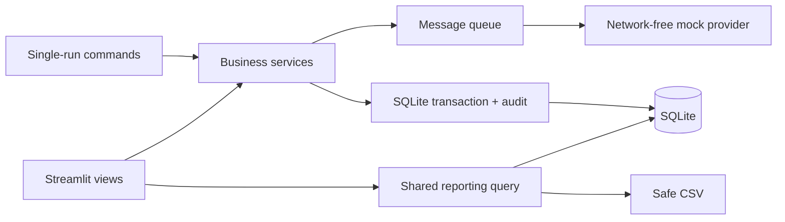

# LearnOps Flow

**Learning Operations Automation Platform**

[English](#english) | [中文](#中文)

## English

A local portfolio prototype that connects training schedules, enrollment, attendance, completion, simulated communications, and operational reporting for a fictional learning team.

**Status: V1 prototype; acceptance review in progress.** Uses **synthetic data / portfolio demo** only. No real employees, authentication, email delivery, or production deployment. See [validation evidence](docs/validation.md), including checks not performed.


## The workflow

Learning coordinators often reconcile separate schedules, rosters, reminders, and completion reports. This prototype puts those steps behind explicit rules and traceable records:

1. Create a course, prepare a draft session, and publish it.
2. Register fictional learners with transactional capacity checks.
3. Preview confirmations, scan reminder rules, and simulate delivery.
4. After the session, save attendance and completion individually or atomically in a batch.
5. Follow up on overdue incomplete records and review the same filtered detail in charts and CSV.

Intended portfolio audiences include Learning Operations Coordinators, Training Administrators, L&D Coordinators, and Learning Systems roles. These are product-design scenarios, not findings from completed user research.

## Implemented modules

| Module | Available behavior |
|---|---|
| Training calendar | Course create/edit/deactivate; date, course, department and status filters; draft create/edit/delete; publish, capacity changes, close and cancel |
| Enrollments | Unique learner/session records, duplicate-safe registration, transactional capacity, cancellation, re-registration cycles, department snapshots, audited corrections |
| Attendance and completion | Independent states, two completion rules, atomic batch saves, correction reasons, late completion, completion revisions |
| Communications | Five versioned templates, rendered snapshots, strict variables, preview, rule scans, unique message keys, stale cancellation, mock failures and maximum three attempts |
| Reports | Shared filters and detail, department/course/month breakdowns, numerators/denominators, two charts, session utilization, UTF-8 BOM CSV with formula protection |
| Audit and boundaries | Real-operation and business timestamps, service-level public read-only checks, no import or real-message integration |

## Quick start — Python 3.12

Run from the repository root. Python 3.12.14 on Windows was validated. Python 3.15 is outside the declared compatibility range. Resolved dependencies are pinned in `requirements-lock.txt`, a constraints file used by the installation commands.

```powershell
python -m venv .venv
.venv\Scripts\Activate.ps1
python -m pip install -r requirements-dev.txt
python -m pip install -e . --no-deps
$env:APP_MODE = 'local_demo'
$env:DATABASE_PATH = 'data/demo.sqlite3'
$env:DISPLAY_TIMEZONE = 'America/Toronto'
$env:MESSAGE_PROVIDER = 'mock'
$env:DEMO_AS_OF = '2026-10-25T14:00:00Z'
python -m scripts.init_db
python -m scripts.seed_demo --seed 42 --base-date 2026-10-25
python -m streamlit run app.py --server.address=127.0.0.1
```

Open the local URL printed by Streamlit, normally `http://127.0.0.1:8501`. Without activation, prefix commands with `.venv\Scripts\python.exe`. Seed creates **200 synthetic learners, 6 departments, 8 courses, 24 sessions and 408 enrollment records**, including cancellations, both completion rules, late completions, full sessions, failed mock deliveries and successful retries.

On macOS/Linux, use `source .venv/bin/activate` and `export APP_MODE=local_demo` (and equivalent assignments for other configuration values). Cross-platform CI is configured but has not run remotely; actual local validation used Windows.

Configuration comes from environment variables. `.env.example` is a reference; `.env` is not loaded automatically. Default `APP_MODE=public_readonly` is deliberate: explicitly enable local writes for initialization and seeding. Default database: `data/demo.sqlite3`; display timezone: `America/Toronto`; only `MESSAGE_PROVIDER=mock` is allowed.

The local sidebar exposes a fixed, explicit Demo Clock. It changes rule evaluation, **not historical database state**. Match `DEMO_AS_OF` to your seed base date when creating a new scenario. Real audit operation timestamps always use the system clock.

## Try the demo

Follow the [3–5 minute walkthrough](docs/demo_script.md). Participants use `learnerNNN@example.com` addresses and fictional names. The selector says **Demo role — no authentication**. Manager views are read-only in the UI; role labels are not a production security system.

Run a single batch without the UI:

```powershell
python -m scripts.run_communications --as-of 2026-10-25T14:00:00Z --mode mock
python -m scripts.run_communications --as-of 2026-10-25T14:00:00Z --mode mock --retry-failed
```

`--fail-first 1`, `2` or `3` injects deterministic failures per message attempt. Rule scanning and processing are separate UI actions. There is no background scheduler or network delivery provider.

Data persists across restarts. Seeding an existing database is refused. To rebuild **only the configured synthetic database**, stop Streamlit and run:

```powershell
python -m scripts.reset_demo --confirm-reset --seed 42 --base-date 2026-10-25
```

Reset requires an explicit flag and a synthetic-database marker. It is absent from the app. A failed partial seed can be reset with the same command; the full seed uses multiple short business transactions.

## Reporting example

The independent automated fixture has two ended sessions of capacity five, eight active enrollments, six present learners, five completions and three overdue incomplete records:

| Metric | Calculation |
|---|---|
| Attendance | 6/8 = 75% |
| Completion | 5/8 = 62.5% |
| Overdue incomplete | 3/8 = 37.5% |
| Record coverage | 7/8 = 87.5% |
| Capacity utilization | 8/10 = 80% |

Future sessions do not enter attendance/completion denominators. Excused and unrecorded attendance remain in the denominator. No denominator means N/A. Department filters hide shared capacity utilization. See [metric definitions](docs/metric_definitions.md).


These are current operational records, not measurements of learning effectiveness, employee performance or real business impact.

## Architecture and verification



Python services are independently testable. Streamlit presents the interface, SQLite provides local transactions, and pandas formats tables/native charts. Read [architecture and entity relationships](docs/architecture.md) and [decisions](docs/decisions.md).

```powershell
python -m pytest -q
python -m ruff check .
python -m ruff format --check .
python -m scripts.benchmark
```

Tests cover constraints, two independent connections competing for one seat, rollback including messages/audit, retries, UTC/DST, the fixed metric fixture, safe exports, repeatable seeds, public boundaries and Streamlit UI paths. The 2026-11-01 local run passed 39 tests; see [validation](docs/validation.md) for the environment and details. A complete manual workflow, keyboard navigation and accessibility/contrast review remain outstanding. No remote CI success or accessibility certification is claimed.

## Troubleshooting

| Symptom | Action |
|---|---|
| Missing package | Activate the intended Python 3.12 environment and install `requirements-dev.txt` |
| Database not initialized | Set local mode, then run initialization and seed from the repository root |
| Read-only error | Explicitly set local mode and restart the server after changing its environment |
| Database busy | Retry after a few seconds; stop other writing processes; do not reset with the app open |
| Port already used | Stop the prior server or add `--server.port=8502` |
| Empty filters | Widen the date range; check display timezone, Demo Clock and seed base date |
| Windows activation blocked | Use `.venv\Scripts\python.exe` directly; no policy change is needed |
| Restricted environment temporary-file error | Use a writable project-local TEMP/TMP directory while creating the venv and installing |

## Boundaries and roadmap

- Public read-only mode opens SQLite read-only, blocks service writes, removes write forms and clock changes, and requires a prebuilt synthetic database. The fixed as-of is operator-configured.
- [Public demo preparation](docs/public_demo.md) explains the reproducible pre-launch build and the local read-only preview. It does not publish anything.
- **Deployment planned**. There is no public demo URL. Single-instance SQLite is not a production persistence or multi-user scale promise.
- No uploads, real employee data, email/SMS, SSO, HRIS, SCORM/xAPI, hosted content or AI scoring. V1 does not evaluate people for employment or compliance decisions.
- Known limits: no historic snapshots, no optimistic attendance edit-conflict detection, no multi-instance scheduling, no comprehensive accessibility audit. Fictional free-text input is permitted; there is no automated detector that guarantees text is synthetic.
- P1: broader accessibility review, visual refinements, public read-only deployment and optional video. None of these future activities is claimed as complete.
- V2: authenticated APIs, PostgreSQL and authorized integrations only when justified. Human-reviewed AI drafts and aggregate summaries remain future exploration.

## Provenance and license

The owner supplied the project direction and approved local development from `PROJECT_SPEC.md` V1.1. Codex generated the implementation and documentation, ran local tests and browser checks, and recorded evidence. Do not present this as independently hand-written code or claim the owner reviewed every line; owner review remains outstanding. No organizational outcomes or time savings were measured.

A license has not been selected. This repository is not represented as licensed open-source software.

---

## 中文

LearnOps Flow 是一个使用虚构组织和合成数据的培训运营作品集原型，将课程排期、报名、出勤、完成记录、模拟沟通与运营报表串联起来。

**当前状态：V1 原型，验收仍在进行。** 应用仅用于演示，不包含真实员工数据、真实身份认证、真实邮件投递或生产部署。自动化测试不能替代完整人工验收；具体结果与限制见[验证记录](docs/validation.md)。应用界面目前为英文。

### 已实现功能

| 模块 | 功能 |
|---|---|
| 培训日历 | 创建、编辑和停用课程；创建及编辑草稿场次；发布、取消、结束场次和调整容量；按日期、课程、部门、状态筛选 |
| 报名 | 按学员和场次维持唯一记录；事务内检查容量；处理重复报名、取消、重新报名周期、报名时部门快照及带审计的更正 |
| 出勤与完成 | 分别记录出勤和完成状态；支持仅凭出勤完成或出勤后人工确认；支持批量原子保存、更正理由、迟完成及完成版本 |
| 模拟沟通 | 五类消息模板、内容预览、规则扫描、去重、失效消息取消、模拟失败和最多三次投递尝试；不发送真实邮件 |
| 报表 | 按日期、课程、部门筛选；查看分子、分母、部门完成率和月度报名趋势；查看场次容量利用率并导出带公式注入防护的 CSV |
| 审计与边界 | 记录变更前后、演示业务时间和真实操作时间；公共只读限制在服务层生效 |

常见演示流程是：创建并发布场次，为虚构学员报名，预览并模拟处理通知，课后记录出勤与完成，再查看未完成跟进和报表。角色切换仅供演示，不代表登录或权限认证。

### 本地启动

以下命令在项目根目录的 Windows PowerShell 中运行。已验证的环境为 Windows 和 Python 3.12.14；依赖版本由 `requirements-lock.txt` 约束。Python 3.15 不在本项目声明的兼容范围内。

```powershell
python -m venv .venv
.venv\Scripts\Activate.ps1
python -m pip install -r requirements-dev.txt
python -m pip install -e . --no-deps
$env:APP_MODE = 'local_demo'
$env:DATABASE_PATH = 'data/demo.sqlite3'
$env:DISPLAY_TIMEZONE = 'America/Toronto'
$env:MESSAGE_PROVIDER = 'mock'
$env:DEMO_AS_OF = '2026-10-25T14:00:00Z'
python -m scripts.init_db
python -m scripts.seed_demo --seed 42 --base-date 2026-10-25
python -m streamlit run app.py --server.address=127.0.0.1
```

打开终端显示的本地地址，通常为 `http://127.0.0.1:8501`。未激活虚拟环境时，可用 `.venv\Scripts\python.exe` 代替 `python`。macOS/Linux 使用 `source .venv/bin/activate` 激活，并使用 `export` 设置环境变量；本次本地验证未覆盖这些系统。

种子生成 200 名虚构学员、6 个部门、8 门课程、24 个场次和 408 条报名记录。已存在业务数据时，种子命令会拒绝重复初始化。`APP_MODE` 默认是 `public_readonly`，本地写入必须显式设置为 `local_demo`；`.env.example` 仅作参考，不会自动加载。

侧边栏的 Demo Clock 用于改变业务规则判断时间，**不会重建历史数据库快照**；实际操作审计时间仍使用系统时钟。[演示脚本](docs/demo_script.md)提供完整的操作顺序。

### 只读预览与模拟沟通

在受信任的本地环境准备一个全新的公开演示数据库；命令不会覆盖现有文件：

```powershell
$env:APP_MODE = 'local_demo'
python -m scripts.prepare_public_demo --database data/public-demo.sqlite3 --seed 42 --base-date 2026-10-25
$env:APP_MODE = 'public_readonly'
$env:DATABASE_PATH = 'data/public-demo.sqlite3'
$env:DEMO_AS_OF = '2026-10-25T14:00:00Z'
python -m streamlit run app.py --server.address=127.0.0.1 --server.port=8502
```

只读模式禁止服务写入，界面不提供写入表单、队列执行、重置或时钟修改。它并非真实身份认证，访问者可以查看全部合成数据；不要将包含未审核自由文本的可写演示数据库用于公开预览。准备步骤及未来发布前检查见[只读演示说明](docs/public_demo.md)。目前没有公开演示地址。

本地也可以单次运行模拟沟通规则及处理；以下命令需要 `APP_MODE=local_demo`，不会发送真实消息：

```powershell
python -m scripts.run_communications --as-of 2026-10-25T14:00:00Z --mode mock
python -m scripts.run_communications --as-of 2026-10-25T14:00:00Z --mode mock --retry-failed
```

需要恢复初始合成数据时，先停止应用，再使用下列显式重置命令。它会修改当前 `DATABASE_PATH` 指向、且带有合成演示标记的数据库：

```powershell
$env:APP_MODE = 'local_demo'
$env:DATABASE_PATH = 'data/demo.sqlite3'
python -m scripts.reset_demo --confirm-reset --seed 42 --base-date 2026-10-25
```

### 指标与验证

独立测试夹具包含两场已结束培训、8 条有效报名、6 人出席、5 人完成和 3 条到期未完成记录：出勤率 **6/8 = 75%**，完成率 **5/8 = 62.5%**，到期未完成率 **3/8 = 37.5%**，记录覆盖率 **7/8 = 87.5%**，容量利用率 **8/10 = 80%**。未来场次不进入出勤率和完成率分母；请假和未记录仍保留在已结束场次的分母中。分母为零时显示 N/A；筛选部门时隐藏共享容量利用率。完整口径见[指标说明](docs/metric_definitions.md)。

```powershell
python -m pytest -q
python -m ruff check .
python -m ruff format --check .
```

2026-11-01 的本地自动化检查通过了 **39 项测试**；测试覆盖容量竞争、事务回滚、消息重试、时间边界、报表夹具、CSV、种子重建和只读边界。完整人工业务流程、键盘导航及浏览器无障碍和对比度检查仍未完成；不宣称已通过远端 CI 或取得无障碍认证。

### 限制与后续方向

- 不支持历史时点重建、多实例调度或多人同时编辑时的冲突检测，也不承诺生产级持久化与扩展能力。
- 不接收真实员工资料，不提供真实邮件、短信、SSO、HRIS、SCORM/xAPI、内容托管或 AI 评分；自由文本输入没有自动识别真实个人信息的功能。
- 后续可先补齐人工和无障碍验收，再评估公开只读演示；API、PostgreSQL 和经授权的真实集成属于未来路线。
- 项目由需求方提供方向，Codex 辅助生成实现、文档并执行已记录的检查；没有测量真实组织收益。仓库尚未选择许可证。
