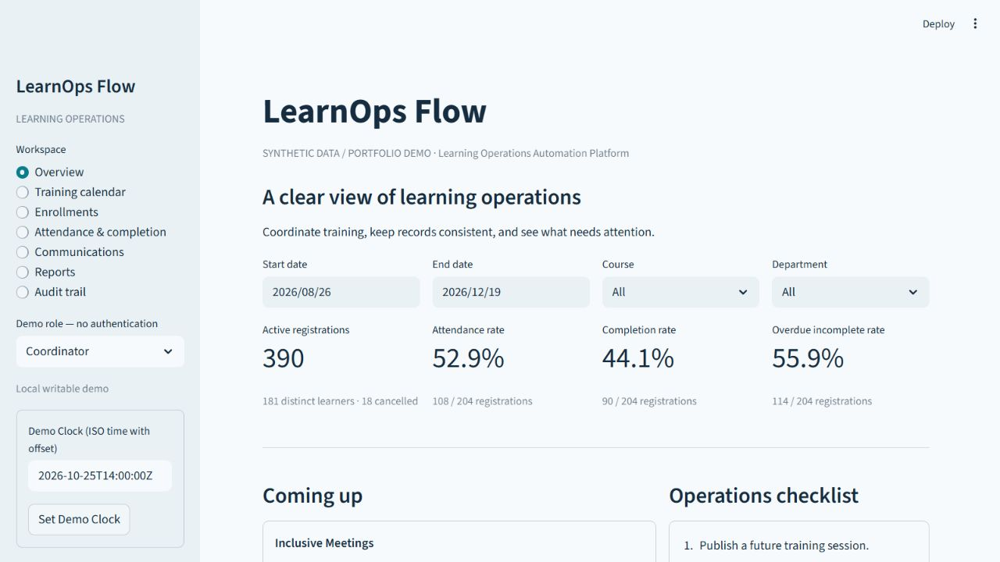
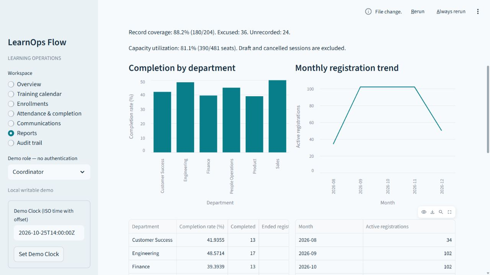
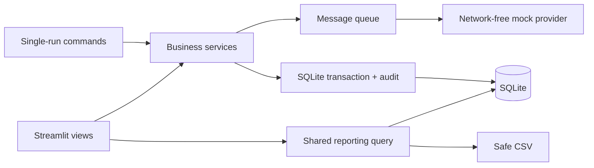

# LearnOps Flow

**Learning Operations Automation Platform**

A local portfolio prototype that connects training schedules, enrollment, attendance, completion, simulated communications, and operational reporting for a fictional learning team.

**Status: V1 P0 implemented and locally validated.** Uses **synthetic data / portfolio demo** only. No real employees, authentication, email delivery, or production deployment. See [validation evidence](docs/validation.md), including checks not performed. GitHub synchronization requires the owner's approval for this batch.



## The workflow

Learning coordinators often reconcile separate schedules, rosters, reminders, and completion reports. This prototype puts those steps behind explicit rules and traceable records:

1. Create a course, prepare a draft session, and publish it.
2. Register fictional learners with transactional capacity checks.
3. Preview confirmations, scan reminder rules, and simulate delivery.
4. After the session, save attendance and completion individually or atomically in a batch.
5. Follow up on overdue incomplete records and review the same filtered detail in charts and CSV.

Intended portfolio audiences include Learning Operations Coordinators, Training Administrators, L&D Coordinators, and Learning Systems roles. These are product-design scenarios, not findings from completed user research.

## Implemented modules

| Module | Available behavior |
|---|---|
| Training calendar | Course create/edit/deactivate; date, course, department and status filters; draft create/edit/delete; publish, capacity changes, close and cancel |
| Enrollments | Unique learner/session records, duplicate-safe registration, transactional capacity, cancellation, re-registration cycles, department snapshots, audited corrections |
| Attendance and completion | Independent states, two completion rules, atomic batch saves, correction reasons, late completion, completion revisions |
| Communications | Five versioned templates, rendered snapshots, strict variables, preview, rule scans, unique message keys, stale cancellation, mock failures and maximum three attempts |
| Reports | Shared filters and detail, department/course/month breakdowns, numerators/denominators, two charts, session utilization, UTF-8 BOM CSV with formula protection |
| Audit and boundaries | Real-operation and business timestamps, service-level public read-only checks, no import or real-message integration |

## Quick start — Python 3.12

Run from the repository root. Python 3.12.14 on Windows was validated. Python 3.15 is outside the declared compatibility range. Resolved dependencies are pinned in `requirements-lock.txt`, a constraints file used by the installation commands.

```powershell
python -m venv .venv
.venv\Scripts\Activate.ps1
python -m pip install -r requirements-dev.txt
python -m pip install -e . --no-deps
$env:APP_MODE = 'local_demo'
$env:DATABASE_PATH = 'data/demo.sqlite3'
$env:DISPLAY_TIMEZONE = 'America/Toronto'
$env:MESSAGE_PROVIDER = 'mock'
$env:DEMO_AS_OF = '2026-10-25T14:00:00Z'
python -m scripts.init_db
python -m scripts.seed_demo --seed 42 --base-date 2026-10-25
python -m streamlit run app.py --server.address=127.0.0.1
```

Open the local URL printed by Streamlit, normally `http://127.0.0.1:8501`. Without activation, prefix commands with `.venv\Scripts\python.exe`. Seed creates **200 synthetic learners, 6 departments, 8 courses, 24 sessions and 408 enrollment records**, including cancellations, both completion rules, late completions, full sessions, failed mock deliveries and successful retries.

On macOS/Linux, use `source .venv/bin/activate` and `export APP_MODE=local_demo` (and equivalent assignments for other configuration values). Cross-platform CI is configured but has not run remotely; actual local validation used Windows.

Configuration comes from environment variables. `.env.example` is a reference; `.env` is not loaded automatically. Default `APP_MODE=public_readonly` is deliberate: explicitly enable local writes for initialization and seeding. Default database: `data/demo.sqlite3`; display timezone: `America/Toronto`; only `MESSAGE_PROVIDER=mock` is allowed.

The local sidebar exposes a fixed, explicit Demo Clock. It changes rule evaluation, **not historical database state**. Match `DEMO_AS_OF` to your seed base date when creating a new scenario. Real audit operation timestamps always use the system clock.

## Try the demo

Follow the [3–5 minute walkthrough](docs/demo_script.md). Participants use `learnerNNN@example.com` addresses and fictional names. The selector says **Demo role — no authentication**. Manager views are read-only in the UI; role labels are not a production security system.

Run a single batch without the UI:

```powershell
python -m scripts.run_communications --as-of 2026-10-25T14:00:00Z --mode mock
python -m scripts.run_communications --as-of 2026-10-25T14:00:00Z --mode mock --retry-failed
```

`--fail-first 1`, `2` or `3` injects deterministic failures per message attempt. Rule scanning and processing are separate UI actions. There is no background scheduler or network delivery provider.

Data persists across restarts. Seeding an existing database is refused. To rebuild **only the configured synthetic database**, stop Streamlit and run:

```powershell
python -m scripts.reset_demo --confirm-reset --seed 42 --base-date 2026-10-25
```

Reset requires an explicit flag and a synthetic-database marker. It is absent from the app. A failed partial seed can be reset with the same command; the full seed uses multiple short business transactions.

## Reporting example

The independent automated fixture has two ended sessions of capacity five, eight active enrollments, six present learners, five completions and three overdue incomplete records:

| Metric | Calculation |
|---|---|
| Attendance | 6/8 = 75% |
| Completion | 5/8 = 62.5% |
| Overdue incomplete | 3/8 = 37.5% |
| Record coverage | 7/8 = 87.5% |
| Capacity utilization | 8/10 = 80% |

Future sessions do not enter attendance/completion denominators. Excused and unrecorded attendance remain in the denominator. No denominator means N/A. Department filters hide shared capacity utilization. See [metric definitions](docs/metric_definitions.md).



These are current operational records, not measurements of learning effectiveness, employee performance or real business impact.

## Architecture and verification



Python services are independently testable. Streamlit presents the interface, SQLite provides local transactions, and pandas formats tables/native charts. Read [architecture and entity relationships](docs/architecture.md) and [decisions](docs/decisions.md).

```powershell
python -m pytest -q
python -m ruff check .
python -m ruff format --check .
python -m scripts.benchmark
```

Tests cover constraints, two independent connections competing for one seat, rollback including messages/audit, retries, UTC/DST, the fixed metric fixture, safe exports, repeatable seeds, public boundaries and Streamlit UI paths. [Validation](docs/validation.md) records actual commands, results, environment, performance samples and limits. No coverage percentage or remote CI success is claimed.

## Troubleshooting

| Symptom | Action |
|---|---|
| Missing package | Activate the intended Python 3.12 environment and install `requirements-dev.txt` |
| Database not initialized | Set local mode, then run initialization and seed from the repository root |
| Read-only error | Explicitly set local mode and restart the server after changing its environment |
| Database busy | Retry after a few seconds; stop other writing processes; do not reset with the app open |
| Port already used | Stop the prior server or add `--server.port=8502` |
| Empty filters | Widen the date range; check display timezone, Demo Clock and seed base date |
| Windows activation blocked | Use `.venv\Scripts\python.exe` directly; no policy change is needed |
| Restricted environment temporary-file error | Use a writable project-local TEMP/TMP directory while creating the venv and installing |

## Boundaries and roadmap

- Public read-only mode opens SQLite read-only, blocks service writes, removes write forms and clock changes, and requires a prebuilt synthetic database. The fixed as-of is operator-configured.
- **Deployment planned**. There is no public demo URL. Single-instance SQLite is not a production persistence or multi-user scale promise.
- No uploads, real employee data, email/SMS, SSO, HRIS, SCORM/xAPI, hosted content or AI scoring. V1 does not evaluate people for employment or compliance decisions.
- Known limits: no historic snapshots, no optimistic attendance edit-conflict detection, no multi-instance scheduling, no comprehensive accessibility audit. Fictional free-text input is permitted; there is no automated detector that guarantees text is synthetic.
- P1: broader accessibility review, visual refinements, public read-only deployment and optional video. None of these future activities is claimed as complete.
- V2: authenticated APIs, PostgreSQL and authorized integrations only when justified. Human-reviewed AI drafts and aggregate summaries remain future exploration.

## Provenance and license

The owner supplied the project direction and approved local development from `PROJECT_SPEC.md` V1.1. Codex generated the implementation and documentation, ran local tests and browser checks, and recorded evidence. Do not present this as independently hand-written code or claim the owner reviewed every line; owner review remains outstanding. No organizational outcomes or time savings were measured.

A license has not been selected. This repository is not represented as licensed open-source software.
