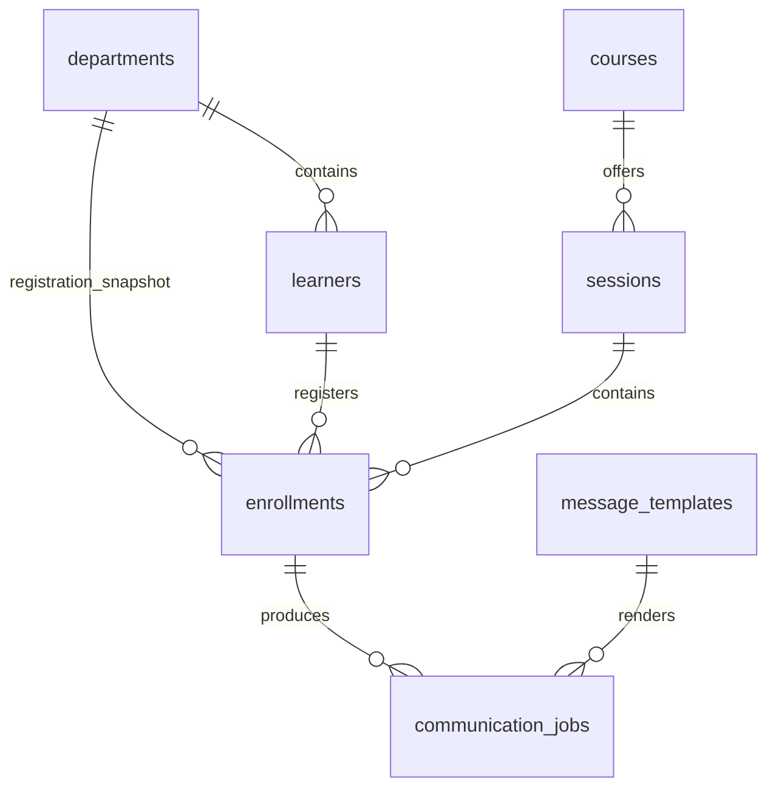

# Architecture

The UI reads through `repository.py` and `reporting.py`; every UI mutation delegates to a service. Services have no Streamlit dependency. A Settings instance, injectable business clock and demo actor label define each operation's context.

`audit_events` stores entity type/ID, before/after JSON, reason, demo actor, actual UTC operation time and business as-of. Logical references preserve audit after draft deletion. `schema_migrations` versions structure; `demo_metadata` identifies seed parameters and synthetic data.

## Transactions

- Connections are short-lived and enable foreign keys. Reads use SQLite URI `mode=ro`, updates use `mode=rw`, and only explicit initialization uses `mode=rwc`.
- Writes use `BEGIN IMMEDIATE`, wait at most five seconds for another writer, and commit business changes, queue changes and audit together. Capacity is counted under this lock.
- Duplicate active registration returns its original ID. Re-registration updates the same record, increments cycle, refreshes the department snapshot and cancels obsolete unsent jobs.
- Unique learner/session and message keys enforce identity. CHECK constraints enforce states, positive integer capacity and attempt bounds.
- Batch attendance uses one transaction; a row error rolls back all rows, notifications and audits. Errors identify the row.
- Publication snapshots the course completion rule. Reversals cancel unsent completion jobs; simulated-sent history remains.
- SQL binds external values. Dynamic table/field names are internal allowlists or constants.

## Communications

Five versioned templates restrict standard-library Formatter fields: no attribute access, conversion or formatting expressions. Required learner/course/date/timezone fields are checked across subject/body. New versions retire prior active templates; existing jobs retain recipient and rendered-content snapshots.

Registration, cancellation and completion enqueue in the originating transaction. Rules generate reminders in `[start - 24h, start)` and follow-ups strictly after due time. Unique keys contain enrollment, cycle, type and, for completion, revision.

Processing revalidates state under the write lock. The built-in mock never opens a network connection. Each attempted delivery increments its counter, with a maximum of three. Reprocessing success is a no-op. This does not claim exactly-once delivery through an external provider.

## Time and reporting

Times use second-precision UTC text. Local input uses IANA zones; nonexistent DST times are rejected, and ambiguous times require first/second occurrence separately for start/end/due. Report local-date ranges become a UTC half-open interval.

Reports read sessions and enrollment details in one read transaction, then derive summaries, groups, charts and CSV from those rows. Formula prefixes are escaped in the custom CSV and dataframes exposed to Streamlit's built-in download. Reports show current database states; clock changes do not reconstruct history.

## Boundary

Default mode is public read-only. Services and database-write access each enforce mode independently of UI visibility. Public mode exposes no initialization, reset, import, queue execution or clock forms. Build synthetic data before exposing the application. Local roles are demonstration labels, not production access control. Bind writable demonstrations to loopback.
